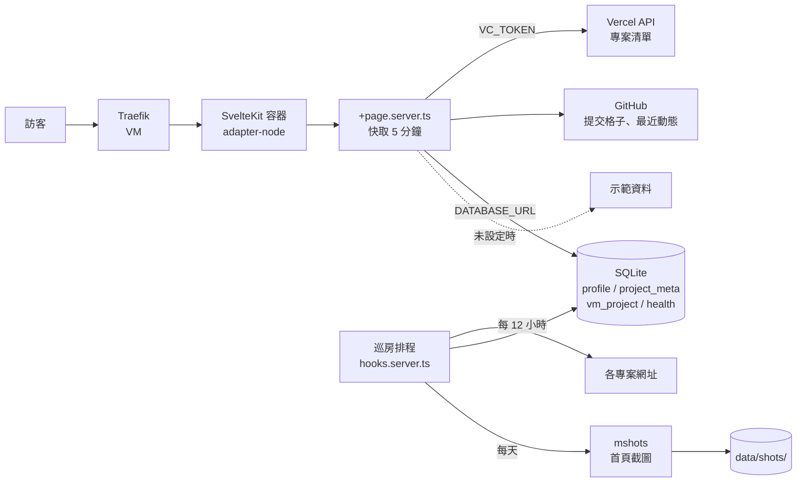

<div align="center">

# doraeyi.com

**兩間 3D 房間的個人作品集：每個上線中的專案都有一位 Q 版管理員顧著，網站掛了管理員就會睡著**


</div>

---

## 📖 簡介

doraeyi.com 是我的個人網站，整個首頁是一個可以拖曳旋轉的 3D 微縮模型：左邊是 **Vercel 房**，右邊是 **VM 機房**（同事 VM 上用 Docker 跑的專案），前面鋪著一張 **GitHub 提交地毯**。

每個專案是一張桌子，桌前坐著一位管理員（機器人、貓或狗）。伺服器每 12 小時會去打一次每個專案的網址：正常的話管理員醒著值班、螢幕是綠的；連不上或回 5xx，管理員就會趴下睡著、頭上飄 Z、桌角的警示燈閃紅光。

## ✨ 功能特色

- 🏠 **兩間 3D 房間**：Vercel 房的清單直接從 Vercel API 抓；VM 機房的專案登記在 SQLite 的 `vm_project` 表
- 😴 **巡房管理員**：每 12 小時健康檢查一次，結果與妥善率存在 SQLite，掛掉的專案管理員會睡著
- 🟪 **GitHub 提交地毯**：過去一年每天的提交數，一天一根柱子（不需要 token）
- 🔳 **整個場景藏著一個 QR code**（ICQR 的做法）：兩間房間、走廊、院子放在同一塊正方形底板上，底板的地磚就是 QR 的格子，平常看是淡淡的拼花地板跟院子裡的樹籬。滾輪滾到最遠或按著往下拉，牆往外倒、家具跟管理員融進地板、深色格子升起變深，鏡頭轉到正上方並收窄視角把透視壓平，整塊底板就是 GitHub 個人頁的 QR code；往上推全部倒帶回來（QR 矩陣在伺服器用 `qrcode` 算好）
- 🖥️ **螢幕顯示專案首頁**：巡房後幫正常的專案拍首頁截圖（WordPress mshots，免費、不用帳號），一天更新一次，存在資料庫旁的 `shots/` 資料夾，貼到桌上的螢幕跟資訊卡；掛掉的專案螢幕會變成紅色 DOWN
- 🗂️ **點桌子看詳情**：網域、上次巡房、回應時間、HTTP 狀態、妥善率、技術、原始碼連結
- 🌙 **跟著台灣時間變化**：晚上窗外變星空、房間點起暖燈
- 📱 **手機也是 3D**：自動降畫質；真的跑不動才改成一般清單
- 🧪 **沒設定也能跑**：缺 Vercel token 時 Vercel 房用示範資料

## 🏗️ 系統架構



## 🧰 技術棧

| 類別 | 技術 |
| --- | --- |
| 框架 | SvelteKit 3、Svelte 5、TypeScript、Vite |
| 視覺 | Three.js |
| 資料 | Vercel REST API、GitHub、SQLite（better-sqlite3） |
| 部署 | Docker（`@sveltejs/adapter-node`）、GitHub Actions、GHCR、VM 上的 Traefik |

## 📂 專案結構

```text
doraeyi/
├── src/
│   ├── hooks.server.ts         # 伺服器一啟動就開始巡房排程
│   ├── routes/
│   │   ├── +page.server.ts     # 取 Vercel、GitHub、資料庫資料
│   │   └── +page.svelte        # 3D 上面那層介面：狀態列、切換列、資訊卡
│   └── lib/
│       ├── components/         # Stage（3D 總管、手勢、降畫質）、PerfPanel
│       ├── room/               # 3D 房間：core（場景）、keepers（管理員）、textures、worker
│       └── server/             # vercel.ts、github.ts、health.ts（巡房）、db.ts、site.ts
├── db/schema.sql               # profile、project_meta、vm_project、health
└── static/
```

## 🌌 3D 與效能

| 模式 | 什麼時候用 | 說明 |
| --- | --- | --- |
| WebGL（Worker） | 瀏覽器支援 OffscreenCanvas | three.js 整個在 Web Worker 跑，主執行緒只處理介面跟手勢 |
| WebGL（主執行緒） | 不支援 OffscreenCanvas | 同一份場景，在主執行緒執行 |
| 清單 | 沒有 WebGL，或降到低畫質還是不到 20 FPS | 一般 HTML 清單 |

- 畫質分兩級：**tier 2** 開即時陰影、解析度上限 1.75 倍；**tier 1** 關陰影、解析度上限 1.25 倍。手機、4 核心以下、記憶體 < 4GB、軟體繪圖一開始就用 tier 1，桌機跑不到 40 FPS 也會自動降
- 牆、地板、桌子等靜態物件合成一個 mesh；管理員一個部位一個 mesh、全部共用同一個頂點色材質；地毯 365 根柱子、假陰影、機櫃燈都用 InstancedMesh。整個場景大約 100 個 draw call、3.5 萬個三角形
- 文字（螢幕、招牌）用 OffscreenCanvas 畫成貼圖，Worker 裡也能畫

**量測**：網址加上 `?debug=perf` 會出現量測面板（模式、FPS、畫質、draw call、GPU），加 `&scene=worker`、`&scene=main`、`&scene=list` 可強制切換模式。

## 😴 巡房規則

- 伺服器啟動時跑一次，之後每小時看一次有沒有超過 12 小時沒檢查的專案；有人逛網站時也會順便看
- 對專案網址發一次 GET（15 秒逾時）：2xx、3xx、4xx 都算有在跑；5xx、逾時、連不上就算掛掉，管理員睡著
- Vercel 回報正式部署失敗（`ERROR`）也算掛掉，不用打網址
- 沒有公開網址的專案不檢查，管理員一直醒著
- 管理員的種類（機器人、貓、狗）在同一間房間裡輪流分配，名字依專案固定

## 🚀 快速開始

```bash
pnpm install
cp .env.example .env   # 不填也能跑，會用示範資料
pnpm dev
```

## ⚙️ 環境變數

| 變數 | 說明 |
| --- | --- |
| `VC_TOKEN` | 到 <https://vercel.com/account/tokens> 建立，用來讀取 Vercel 房的專案清單 |
| `VC_TEAM_ID` | 專案放在 Team 底下才需要 |
| `DATABASE_URL` | SQLite 檔案路徑，沒設就用 `data/doraeyi.db`；VM 上由 compose 設成 `/data/doraeyi.db` |

> 變數名稱不能用 `VERCEL_` 開頭（Vercel 保留給系統變數），所以這裡用 `VC_`。

## 🗄️ 資料表

| 資料表 | 用途 |
| --- | --- |
| `profile` | 名字、介紹、技能、連結 |
| `project_meta` | 以 Vercel 專案名稱為 key，補中文名稱、介紹、標籤、`hidden`、`featured` |
| `vm_project` | VM 機房的專案（Vercel 抓不到，手動登記）；新增一列就多一張桌子 |
| `health` | 每個專案最近一次巡房結果，加上累計檢查、失敗次數（算妥善率） |
| `screenshot` | 每個專案最近一次拍首頁截圖的時間；圖檔在資料庫旁邊的 `shots/` |

資料表定義在 `db/schema.sql`，伺服器第一次連線時會自動建立，`profile` 跟 `vm_project` 也會放入 `src/lib/server/fallback.ts` 的預設值（VM 上一開始有 blog 跟 doraeyi.com）。

在 VM 上修改資料（改完最多 5 分鐘後網站會更新，或重啟容器馬上生效）：

```bash
cd ~/doraeyi-site
sqlite3 data/doraeyi.db
```

```sql
INSERT INTO project_meta (vercel_name, title, description, tags, featured)
VALUES ('yi-wallet', 'YIWallet', '記帳 App……', json_array('記帳', 'PWA'), 1);

-- VM 上多跑了一個專案，機房就會多一張桌子
INSERT INTO vm_project (slug, title, description, url, tags)
VALUES ('punch', '打卡系統', '……', 'https://punch.doraeyi.com', json_array('Docker'));
```

## 🚢 部署

跟 blog 同一套：推到 `main` 會觸發 `.github/workflows/deploy.yml`。

1. **check**：`pnpm check`（型別檢查）＋ `pnpm lint`（ESLint），失敗就停，線上繼續跑上一版
2. **build-and-push**：build Docker image，推到 `ghcr.io/doraeyi/doraeyi-site`（`latest` 跟 commit SHA 兩個 tag）
3. **deploy**：在 VM 的 self-hosted runner 上，把 `docker-compose.yml` 同步到 `~/doraeyi-site/`，然後 `docker compose pull && up -d`

對外由 VM 上的 Traefik 轉進來：容器接 `web` 外部網路，router `doraeyi-site` 比對 `doraeyi.com` 跟 `www.doraeyi.com`，轉到容器的 3100 port。

`.env` 只放在 VM 的 `~/doraeyi-site/.env`，不進 git，workflow 也不會動它。SQLite 資料庫掛在 VM 的 `~/doraeyi-site/data/`，重新部署不會不見；要備份就複製 `data/doraeyi.db`。
