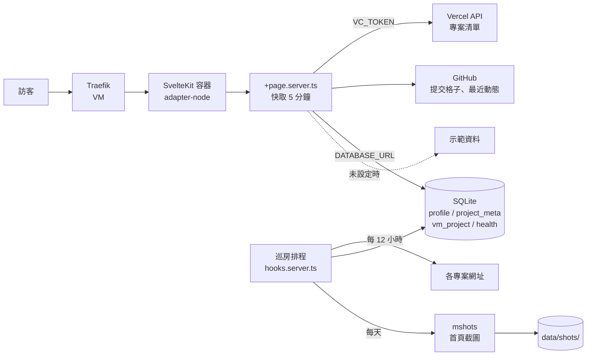

<div align="center">

# doraeyi.com

**兩間 3D 房間的個人作品集：每個上線中的專案都有一位 Q 版管理員顧著，網站掛了管理員就會睡著**


</div>

---

## 📖 簡介

doraeyi.com 是我的個人網站，整個首頁是一個可以拖曳旋轉的 3D 微縮模型：一棟有後花園的小工作室：房子左邊是 **工作室**（部署在 Vercel 的專案），右邊是 **機房**（同事 VM 上用 Docker 跑的專案），中間是玄關；房子前面一條木頭露台，後花園裡有一片 **GitHub 提交果園**，一天一棵樹。我用 Claude Code 改哪個專案，那張桌子的管理員就跟著工作；push 上去，它就走去花園幫今天的樹澆水。

每個專案是一張桌子，桌前坐著一位管理員（機器人、貓或狗）。伺服器每 12 小時會去打一次每個專案的網址：正常的話管理員醒著值班、螢幕是綠的；連不上或回 5xx，管理員就會趴下睡著、頭上飄 Z、桌角的警示燈閃紅光。

## ✨ 功能特色

- 🏠 **兩間 3D 房間**：左邊工作室的清單直接從 Vercel API 抓；右邊機房的專案登記在 SQLite 的 `vm_project` 表（牆上不掛招牌）。房間跟花園之間隔著一整片落地玻璃，變成 QR 時收起來
- 😴 **巡房管理員**：每 12 小時健康檢查一次，結果與妥善率存在 SQLite，掛掉的專案管理員會睡著；上方「N 位睡著了」可以點，鏡頭直接飛到睡著的那張桌子
- 🚶 **走進去**：切換列的「走進去」換成第一人稱，從玄關門口出發，桌面用 WASD／方向鍵走（Shift 跑）、拖曳轉頭，手機用左下角的搖桿；牆、桌子、機櫃、草叢、落地玻璃都穿不過去，玄關兩邊各有一道門通往兩間房間，要去花園得從玄關的玻璃自動門出去（走近就自動打開）。走到電腦前會出現「E 看 xxx」，按 E（手機點一下）打開那個專案的資訊卡；Esc 離開
- 🌳 **GitHub 提交果園**：過去一年每天的提交數，一天一棵樹，提交越多長越高、樹冠越大越綠；沒提交的那天只有一小撮草（不需要 token）
- 🧑‍💻 **管理員跟著我一起工作**：電腦上的 Claude Code 在改哪個專案，那張桌子的管理員就盯著螢幕狂打字、螢幕捲程式碼、頭上冒「…」；Claude 做完一輪在等回覆，管理員轉過來歪頭、頭上打勾。Claude 一下 `git push`，管理員就拿起澆水壺出發：在碰撞地圖上找路（A*），從房間側門走進玄關、穿過名牌底下那道便利商店式的玻璃自動門（有人靠近感應燈變綠、兩扇門往旁邊滑開），繞過桌子、其他管理員、草叢跟花圃，走到今天那棵樹旁邊，從壺嘴往樹根澆水。GitHub 收到之後繼續澆，GitHub Actions 全部跑完（部署完成）樹才長大，再走回位子；好幾位同時澆就在樹旁邊排開。設定方式見〈管理員的工作狀態〉
- 🔳 **房子上空拼出一個 QR code（視角錯覺）**：滾輪滾到最遠、按著往下拉或按「QR」，地板跟花園裡屬於 QR 深色格子的那幾格先從三個定位角往外凸起來，接著一塊塊從地上拔起來（地上留下洞），帶著原本的木地板、石磚、機房地板、草叢的顏色跟紋路，邊轉邊飛到房子上空不同的高度。鏡頭先繞到側邊讓人看清楚一堆漂浮的地板碎片，再滑到一個固定的位置（P），碎片在最後一刻「喀」一聲拼成 GitHub 個人頁的 QR code，同時燒成同材質的深色、房子淡成一張淺色的紙。做法：每一塊都擺在從 P 看向底板那一格的視線上，越靠近 P 縮得越小、側面也順著視線收斜，所以只有從 P 看才對得齊；P 依畫面大小算出來，換尺寸就重排；紋路用碎片還在地上時的座標算，飛起來也黏在上面。QR 模式可以左右拖、往下拖離開 P，碎片散開、變回地板的顏色，放手彈回去對準；往上推倒帶回房間（QR 矩陣在伺服器用 `qrcode` 算好）。手機掃不到自己的螢幕，所以 QR 卡片有「存圖」（`/qr.png`）跟「分享」（系統分享面板）
- 🖥️ **螢幕顯示專案首頁**：巡房後幫正常的專案拍首頁截圖（WordPress mshots，免費、不用帳號），一天更新一次，存在資料庫旁的 `shots/` 資料夾，貼到桌上的螢幕跟資訊卡；掛掉的專案螢幕會變成紅色 DOWN
- 🗂️ **點桌子看詳情**：網域、上次巡房、回應時間、HTTP 狀態、妥善率、技術、原始碼連結
- 🌙 **跟著台灣時間變化**：晚上窗外變星空、房間點起暖燈
- 📱 **手機也是 3D**：自動降畫質；真的跑不動才改成一般清單
- 🔗 **分享預覽圖**：貼到 LINE、IG、Facebook 會出現 `static/og.jpg`（1200×630，場景截圖加一句介紹）
- 🧪 **沒設定也能跑**：缺 Vercel token 時工作室用示範資料

## 🏗️ 系統架構



## 🧰 技術棧

| 類別 | 技術 |
| --- | --- |
| 框架 | SvelteKit 3、Svelte 5、TypeScript、Vite |
| 視覺 | Three.js |
| 資料 | Vercel REST API、GitHub、SQLite（better-sqlite3） |
| 部署 | Docker（`@sveltejs/adapter-node`）、GitHub Actions、GHCR、VM 上的 Traefik |

## 📂 專案結構

```text
doraeyi/
├── src/
│   ├── hooks.server.ts         # 伺服器一啟動就開始巡房排程
│   ├── routes/
│   │   ├── +page.server.ts     # 取 Vercel、GitHub、資料庫資料
│   │   └── +page.svelte        # 3D 上面那層介面：狀態列、切換列、資訊卡
│   └── lib/
│       ├── components/         # Stage（3D 總管、手勢、降畫質）、PerfPanel
│       ├── room/               # 3D 房間：core（場景）、keepers（管理員）、textures、worker
│       └── server/             # vercel.ts、github.ts、health.ts（巡房）、db.ts、site.ts
├── db/schema.sql               # profile、project_meta、vm_project、health
└── static/
```

## 🌌 3D 與效能

| 模式 | 什麼時候用 | 說明 |
| --- | --- | --- |
| WebGL（Worker） | 瀏覽器支援 OffscreenCanvas | three.js 整個在 Web Worker 跑，主執行緒只處理介面跟手勢 |
| WebGL（主執行緒） | 不支援 OffscreenCanvas | 同一份場景，在主執行緒執行 |
| 清單 | 沒有 WebGL，或降到低畫質還是不到 20 FPS | 一般 HTML 清單 |

- 畫質分兩級：**tier 2** 開即時陰影、解析度上限 1.75 倍；**tier 1** 關陰影、解析度上限 1.25 倍。手機、4 核心以下、記憶體 < 4GB、軟體繪圖一開始就用 tier 1，桌機跑不到 40 FPS 也會自動降
- 牆、地板、桌子等靜態物件合成一個 mesh；管理員一個部位一個 mesh、全部共用同一個頂點色材質；果園 365 棵樹（樹幹、樹冠各一個）、地磚、假陰影、機櫃燈都用 InstancedMesh，QR 的方塊合成一個每格動態更新的 mesh；木紋、牆面、碎石、草叢的紋路在 shader 裡用世界座標算（`src/lib/room/detail.ts`），不載入圖片。整個場景大約 100 個 draw call、3.5 萬個三角形
- 文字（螢幕、招牌）用 OffscreenCanvas 畫成貼圖，Worker 裡也能畫

**量測**：網址加上 `?debug=perf` 會出現量測面板（模式、FPS、畫質、draw call、GPU），加 `&scene=worker`、`&scene=main`、`&scene=list` 可強制切換模式。

## 😴 巡房規則

- 伺服器啟動時跑一次，之後每小時看一次有沒有超過 12 小時沒檢查的專案；有人逛網站時也會順便看
- 對專案網址發一次 GET（15 秒逾時）：2xx、3xx、4xx 都算有在跑；5xx、逾時、連不上就算掛掉，管理員睡著
- Vercel 回報正式部署失敗（`ERROR`）也算掛掉，不用打網址
- 沒有公開網址的專案不檢查，管理員一直醒著
- 管理員的種類（機器人、貓、狗）在同一間房間裡輪流分配，名字依專案固定

## 🧑‍💻 管理員的工作狀態

兩個來源，都只送「哪個 repo、現在什麼狀態」，不送對話內容或程式碼：

- **Claude 在做事**：Claude Code 的 hook（`scripts/claude-presence.mjs`）在開工、呼叫工具（一分鐘最多一次）、做完一輪、關掉 session 時打 `POST /api/presence`，帶著 `PRESENCE_TOKEN`。呼叫工具時回報「做事中」，15 分鐘沒消息當作停了；做完一輪是「等回覆」，30 分鐘後消失
- **push 到部署完成**：hook 看到 Claude 要 `git push` 時多帶 `push: true`，管理員先出發（pushing）；GitHub webhook 的 `push` 事件表示 GitHub 收到了（deploying）；`workflow_run` 事件追蹤這次 push 觸發的 GitHub Actions，全部跑完才算澆完（done）。手動 push 從 GitHub 收到那刻開始；沒有 CI 的 repo 收到後 25 秒收工；開始 push 3 分鐘 GitHub 都沒收到就當作沒推成功。webhook 用 `GITHUB_WEBHOOK_SECRET` 驗簽章（`X-Hub-Signature-256`），要勾 push 跟 workflow_run 兩種事件
- 前端平常每 15 秒問一次 `GET /api/live`，有人在澆水時 4 秒一次；剛打開網頁時，還在澆的會接著演，已經澆完的不演
- 公司的專案：工作室固定一張「公司」桌子，名稱、網址、程式都不公開，不巡房、不澆水。公司電腦上的 PowerShell 跑一行就裝好（`-AllWork`：這台電腦的每個 session 都只送 `work`，不送 git remote、資料夾名稱）：
  `iwr https://raw.githubusercontent.com/doraeyi/doraeyi.com/main/scripts/install-hook.ps1 -OutFile $env:TEMP\doraeyi-hook.ps1; powershell -ExecutionPolicy Bypass -File $env:TEMP\doraeyi-hook.ps1 -AllWork`
  只想讓某些資料夾算公司的，改用 `-WorkDir D:\Workspace`（寫進 `~/.claude/doraeyi-presence.json` 的 `workDirs`）
- 哪個專案：看 Claude 實際動到的 repo（讀檔、改檔、搜尋帶的路徑，或 Bash 指令 `cd` 到的資料夾），以最後動到的為準；還沒動到檔案前先用 session 開在哪個資料夾
- 對到哪張桌子：先比 repo（`owner/name`），對不到再拿資料夾名稱或 repo 名稱比專案代號、專案的 repo 名、網站網域（repo 叫 `doraeyi.com`、網站在 `doraeyi.com` 也算）。一個 monorepo 對到好幾個專案，每位管理員都會動；webhook 來的 repo 網站上沒有，就依名稱固定挑一位去澆水

設定步驟：

1. 產生一串夠長的亂碼（例如 `openssl rand -hex 32`）當 `PRESENCE_TOKEN`，寫進 VM 上 `~/doraeyi-site/.env`，`docker compose up -d`。`GITHUB_WEBHOOK_SECRET` 可以留空，網站會從 `PRESENCE_TOKEN` 算出來
2. 在 `~/.claude/settings.json` 的 `hooks` 裡，`UserPromptSubmit`、`PreToolUse`、`Stop`、`Notification`、`SessionEnd` 都加一個 `node <路徑>/claude-presence.mjs` 的 command hook
3. Windows 上跑 `powershell -ExecutionPolicy Bypass -File scripts\setup-live.ps1`：貼上 `PRESENCE_TOKEN`（隱藏輸入，會先打一次網站確認），設好使用者環境變數 `DORAEYI_PRESENCE_TOKEN`，再幫自己所有的 repo 加 webhook（`https://doraeyi.com/api/github`、`application/json`、只收 push），最後叫 GitHub 送 ping 確認網站收得到。webhook 的 Secret 用 `-FromPresence` 從 `PRESENCE_TOKEN` 算，不用另外搬密碼
4. 重開 Claude Code

webhook 的 **Content type 一定要是 `application/json`**，表單格式會被 SvelteKit 的 CSRF 檢查擋掉。

## 🚀 快速開始

```bash
pnpm install
cp .env.example .env   # 不填也能跑，會用示範資料
pnpm dev
```

網址參數：`?at=vercel:dinner-vote` 直接打開某個專案的資訊卡（也可以是 `vercel`、`vm`、`github`、`about`；打開卡片時網址會自己跟著變，可以直接複製分享）、`?capture` 錄影用（最高畫質、不自動降級）、`?night=1`／`?night=0` 固定晚上或白天、`?scene=list` 直接看清單版、`?debug=perf` 顯示效能面板。

### 單元測試

```bash
pnpm test
```

用 vitest 測伺服器邏輯：巡房判斷（只有 5xx、逾時、連不上才算掛）、妥善率累計（用暫存資料夾的新資料庫，不碰 `data/`）、GitHub 提交格子的解析、管理員名字跟台灣晚上的判斷。不用網路，一秒內跑完。

### QR 掃描測試

```bash
pnpm test:qr
```

會先 build、開一台正式版伺服器，再用 Playwright 開網站按「QR」，拍畫面交給 jsQR 解，白天／晚上 × 桌面／手機四種都要解出 `https://github.com/doraeyi`。改了地磚顏色、燈光或鏡頭之後跑一次。本機借用系統裝的 Chrome，CI 用 Playwright 下載的 Chromium（沒有 GPU，用軟體算圖）。

## ⚙️ 環境變數

| 變數 | 說明 |
| --- | --- |
| `VC_TOKEN` | 到 <https://vercel.com/account/tokens> 建立，用來讀取工作室（Vercel）的專案清單 |
| `VC_TEAM_ID` | 專案放在 Team 底下才需要 |
| `PRESENCE_TOKEN` | Claude Code hook 回報工作狀態用的密碼；沒設就不收 |
| `GITHUB_WEBHOOK_SECRET` | GitHub webhook 的 Secret，驗證 push 真的是 GitHub 送的；留空就從 `PRESENCE_TOKEN` 算（HMAC），兩個都沒設就不收 |
| `DATABASE_URL` | SQLite 檔案路徑，沒設就用 `data/doraeyi.db`；VM 上由 compose 設成 `/data/doraeyi.db` |

> 變數名稱不能用 `VERCEL_` 開頭（Vercel 保留給系統變數），所以這裡用 `VC_`。

## 🗄️ 資料表

| 資料表 | 用途 |
| --- | --- |
| `profile` | 名字、介紹、技能、連結 |
| `project_meta` | 以 Vercel 專案名稱為 key，補中文名稱、介紹、標籤、`hidden`、`featured` |
| `vm_project` | 機房（VM）的專案（Vercel 抓不到，手動登記）；新增一列就多一張桌子 |
| `health` | 每個專案最近一次巡房結果，加上累計檢查、失敗次數（算妥善率） |
| `screenshot` | 每個專案最近一次拍首頁截圖的時間；圖檔在資料庫旁邊的 `shots/` |
| `presence` | 每個 Claude Code session 現在在做哪個 repo、做事中還是等回覆；一天沒消息就刪掉 |
| `watering` | 一次 push 從開始到部署完成：開始時間、GitHub 收到的 commit、還在跑的 GitHub Actions、完成時間（只留最近一天） |

資料表定義在 `db/schema.sql`，伺服器第一次連線時會自動建立，`profile` 跟 `vm_project` 也會放入 `src/lib/server/fallback.ts` 的預設值（VM 上一開始有 blog 跟 doraeyi.com）。

在 VM 上修改資料（改完最多 5 分鐘後網站會更新，或重啟容器馬上生效）：

```bash
cd ~/doraeyi-site
sqlite3 data/doraeyi.db
```

```sql
INSERT INTO project_meta (vercel_name, title, description, tags, featured)
VALUES ('yi-wallet', 'YIWallet', '記帳 App……', json_array('記帳', 'PWA'), 1);

-- VM 上多跑了一個專案，機房就會多一張桌子
INSERT INTO vm_project (slug, title, description, url, tags)
VALUES ('punch', '打卡系統', '……', 'https://punch.doraeyi.com', json_array('Docker'));
```

## 🚢 部署

跟 blog 同一套：推到 `main` 會觸發 `.github/workflows/deploy.yml`。

1. **check**：`pnpm check`（型別檢查）＋ `pnpm lint`（ESLint），失敗就停，線上繼續跑上一版
   **qr**（同時跑）：`pnpm test:qr`，QR 掃不出來也不部署；失敗的畫面會存成 `qr-screens` artifact
2. **build-and-push**：build Docker image，推到 `ghcr.io/doraeyi/doraeyi-site`（`latest` 跟 commit SHA 兩個 tag）
3. **deploy**：在 VM 的 self-hosted runner 上，把 `docker-compose.yml` 同步到 `~/doraeyi-site/`，然後 `docker compose pull && up -d`

對外由 VM 上的 Traefik 轉進來：容器接 `web` 外部網路，router `doraeyi-site` 比對 `doraeyi.com` 跟 `www.doraeyi.com`，轉到容器的 3100 port。

`.env` 只放在 VM 的 `~/doraeyi-site/.env`，不進 git，workflow 也不會動它。SQLite 資料庫掛在 VM 的 `~/doraeyi-site/data/`，重新部署不會不見；要備份就複製 `data/doraeyi.db`。
